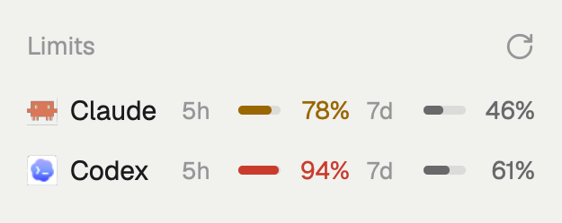

# Agent Limits

A panel at the bottom of the sidebar, right under the Agents list, that shows how much of each coding agent's usage limits the person has used: one line per agent (Claude, Codex), each with a 5-hour and a 7-day bar and percentage. It reads the agents' own records every 30 seconds and asks Anthropic's and OpenAI's servers at start, every 5 minutes, and from a refresh button in its header.

## What you see

- A block 106 px tall below the `agents` block, in the same sidebar column, on the theme's `chrome` background with a 1 px `border` line on top. That line is the divider from the Agents list.
- A header row 41 px tall (`px(16)`, `pt(14)`, `pb(5)`): "Limits" at 11.5 px, medium weight, in `dim`. On the right, a 14 px rotate-cw refresh icon in `dim` (`foreground` on hover, tooltip "Fetch usage from Claude and Codex"). When something failed, a red `!` (11 px, semibold, `blocked`) sits left of the icon, and its tooltip holds the error lines.
- One row per agent with data, 28 px tall, `px(8)` inside an 8 px column padding, radius 8, `hover` background on hover:
  - the agent's icon at 14 px (`icons/claude.svg`, `icons/codex.svg` from the app home), at 50% opacity when no agent of that kind is running;
  - the name ("Claude", "Codex") at 12.5 px, `foreground` when running, `muted` otherwise, truncating;
  - two fixed slots, 78 px each with 8 px between: the short window (under a day) then the long one. A slot is a label in a 22 px column (11 px, `dim`: "5h", "7d", "30d"), a 20×4 px bar on `border` with a fill of the percentage, and a right-aligned 28 px percentage at 11.5 px. A missing window leaves its slot blank so columns line up across rows;
  - "No limit" in `dim` instead of the slots when the server says the account has no limits.
- Below 70%, fill and number are `muted` (`dim` when not running). From 70% they are `working` (amber), from 90% `blocked` (red) and semibold.
- With no data yet: "No limit data yet." at 12 px in `dim`.
- Below 160 px sidebar width (the rail): each agent's icon with its highest percentage under it at 10 px, colored the same way, or "–".

## How it behaves

- Hovering a row shows a tooltip: name, each window's reset time (5h as `HH:MM`, 7d as `Ddd HH:MM`, longer as `M/D HH:MM`) and "updated N m ago".
- A window whose reset time has passed shows 0% until new data arrives.
- Timers: local read at start and every 30 s; server check at start, every 5 min, and on the refresh icon. Only one server check runs at a time; a click during one does nothing.
- A server answer always replaces what is shown. A local read only replaces it if no run started later has already been shown, so a slow old read can't put back older numbers.
- Server errors stay on the `!` until the next server check; local errors until the next local read.
- Agent status changes (`agents()`) redraw the running/dimmed state without polling.

## Built from

- Layout: a `block` `{ "id": "agent-limits", "content": { "mod": "agent-limits" }, "size": { "px": 106 } }` placed right after the block whose id is `agents`, in the same column. `mod.json` is `{ "place": "none" }`, so it shows only where a layout puts it.
- `main.js` (gpui-kit `View`): `agents()`, `exec`, `appHome()`, `theme()`, `layout()` from `herdr`. Running agents are matched by `agent.app` (`claude-code`, `codex`) or `program.key`. The rail check finds the node with id `sidebar` and compares its `size.px` with 160, like the shipped `agents` mod.
- `limits.sh` prints a JSON array `[{agent, name, updated_at, unlimited?, windows: [{label, minutes, pct, resets_at}]}]` and, with `--live`, first asks the servers in parallel:
  - Claude: the OAuth token from the macOS Keychain item `Claude Code-credentials` (`security find-generic-password -w`), else `~/.claude/.credentials.json`; `GET https://api.anthropic.com/api/oauth/usage` with `anthropic-beta: oauth-2025-04-20`. `five_hour.utilization` and `seven_day.utilization` are percentages, `resets_at` ISO 8601. Saved to `~/.cache/agent-limits/claude-server.json`; both null means no limits.
  - Codex: `codex app-server` over stdio (a FIFO keeps stdin open), `initialize`, `initialized`, then `account/rateLimits/read`; `rateLimits.primary` / `secondary` give `usedPercent`, `windowDurationMins`, `resetsAt`. Saved to `~/.cache/agent-limits/codex.json`. Skipped unless `~/.codex/auth.json` has `auth_mode: "chatgpt"`.
  - Local: `~/.cache/agent-limits/claude.json` from `statusline.sh`, and the newest `token_count` event with a non-null `rate_limits.primary` or `secondary` in the 10 most recently modified `~/.codex/sessions/**/*.jsonl` of the last 8 days. For each agent, the newer of local and server data wins by `updated_at`.
- `statusline.sh`: an optional Claude Code `statusLine` command. It saves `rate_limits` from its stdin when they change, then pipes the same stdin to its arguments, if any.
- Art: `refresh.svg`, Lucide rotate-cw, stroke `currentColor` so `svg()` tints it.

## Watch out

- Resumed Codex sessions append to their original dated file, so pick files by modification time, not by path.
- Some Codex log events carry `rate_limits` with `primary: null`; don't take the last line blindly.
- The Claude statusline repeats the last answer's numbers on every redraw. Stamping each redraw as new data would bury a fresher server answer; only write when the value changes.
- The usage endpoint answers 429 when asked too often. Every save of a mod file reloads the mod and triggers a server check, so editing quickly can hit it. Store `now + Retry-After` (10 minutes if missing or a date) and skip Claude until then.
- `label` is a jq keyword; name helper functions something else.
- Keep the token off the command line: `printf 'Authorization: Bearer %s\n' | curl -H @-`.
- Put the user's `PATH` first: several `codex` installs may exist, and the one they use is the one that knows their sign-in.
- A label like "30d" wraps in a narrow column; give labels 22 px and `whitespace_nowrap()`.
- `exec("sh", ...)` makes the mod macOS/Linux only.

## Done when

- `herdr-app check mods/agent-limits` passes and the block shows under Agents with a divider line above "Limits".
- With Claude Code and Codex signed in, both rows show 5h and 7d percentages that match `/usage` in Claude Code and `/status` in Codex.
- Clicking the refresh icon updates the "updated" time in the row tooltips to "just now".
- A row turns amber at 70% and red at 90%.
- An account whose plan has only a weekly limit shows its 7d slot and a blank 5h slot, aligned with the other row.
- Stopping the network and clicking refresh shows `!` with "could not reach the server"; the rows keep their last numbers.
